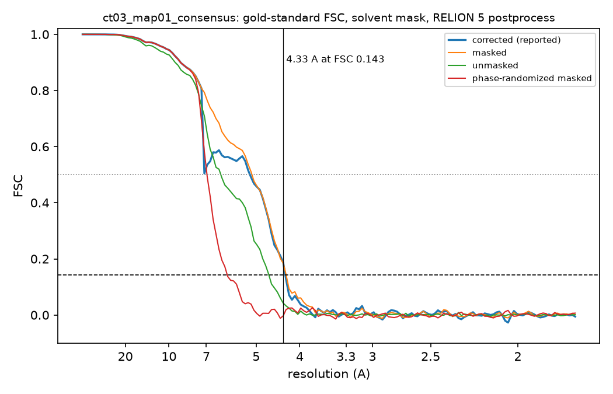
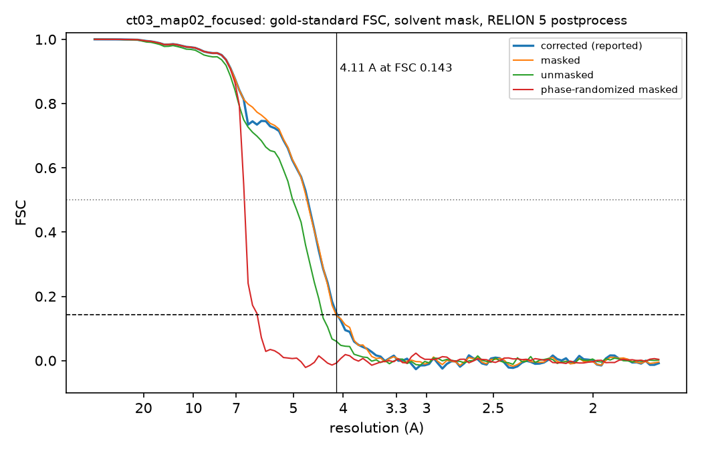
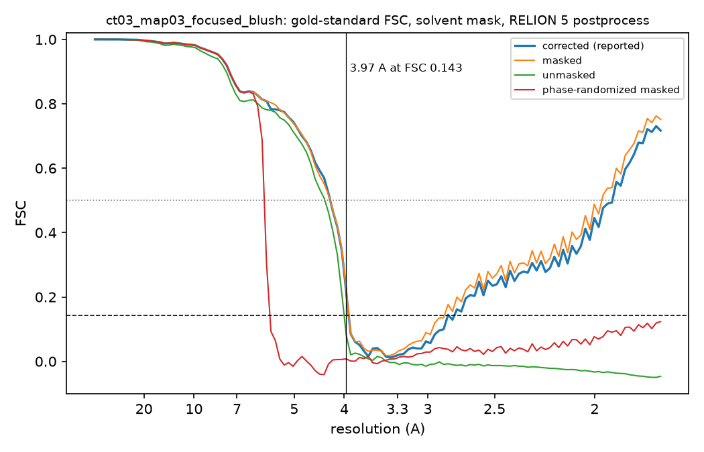
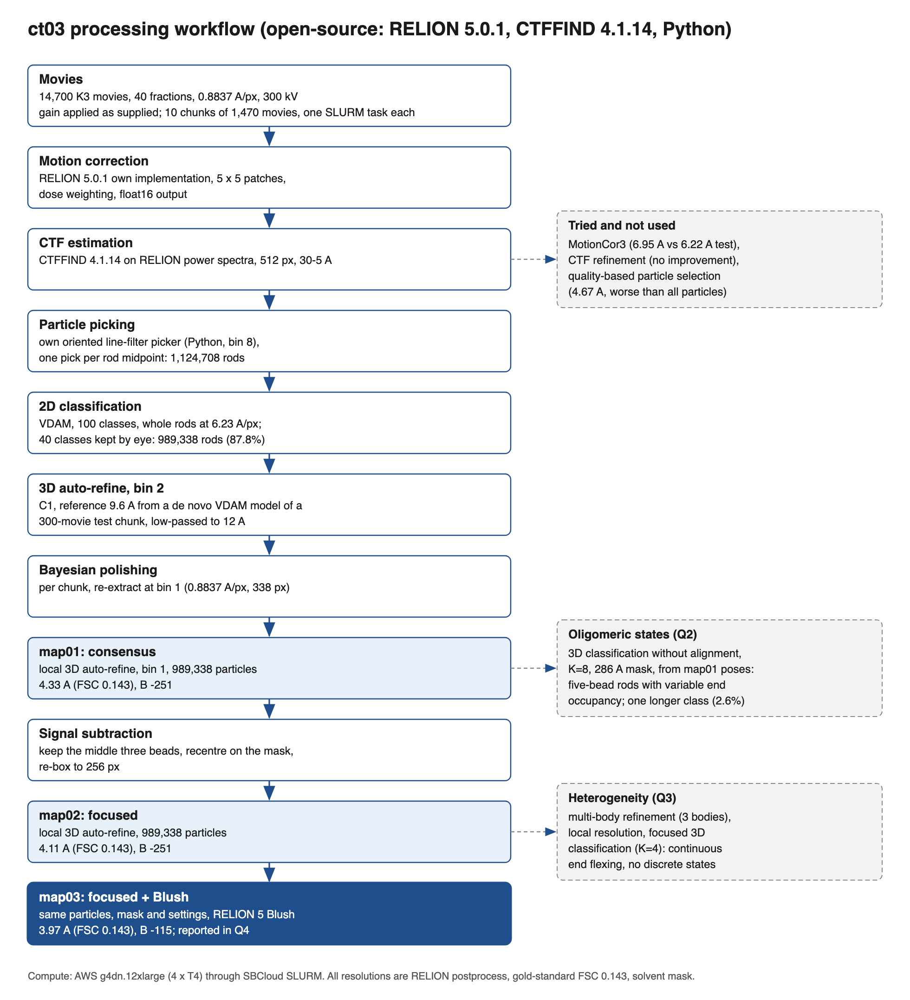
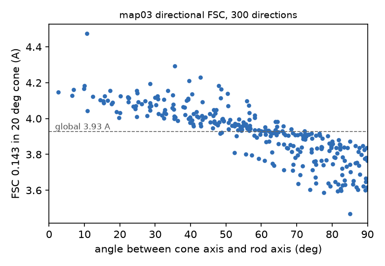
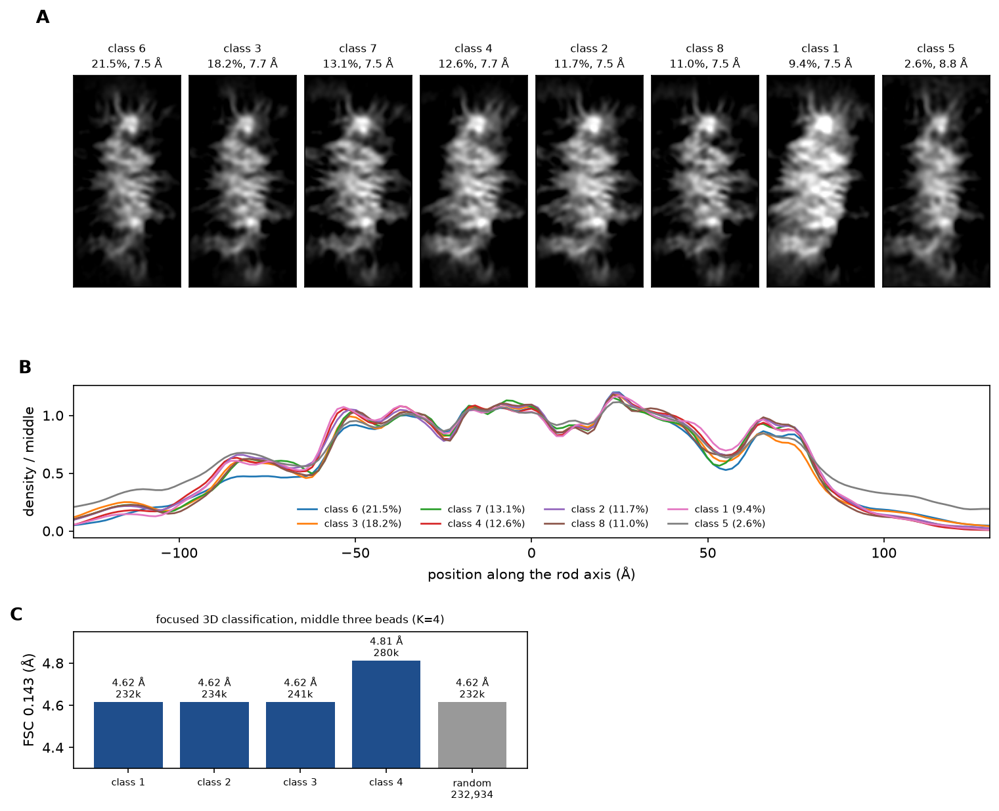

# SBCloud CryoEM Tournament 2026: team ct03g

This repository documents our entry in the SBCloud CryoEM Tournament 2026, run by SBGrid on an AWS-backed SLURM cluster (SBCloud). Teams received the same cryo-EM movie dataset, a compute allocation, and a submission form with five scientific questions. Our entry was in the open-source category, so every step used open-source software.

We did not reach the tournament's 3.3 Å target. Our best map is 3.97 Å, by gold-standard FSC at 0.143, over the middle part of the particle. This README describes what we did, what worked, what did not, and where our interpretation is uncertain.

The dataset itself is not in this repository. The figures here were made from our own maps on the cluster.

## Contents

- [Results](#results)
- [Workflow](#workflow)
- [Data and acquisition](#data-and-acquisition)
- [Preprocessing](#preprocessing)
- [Particle picking](#particle-picking)
- [2D classification](#2d-classification)
- [Map01: consensus refinement](#map01-consensus-refinement)
- [Map02: focused refinement](#map02-focused-refinement)
- [Map03: focused refinement with Blush](#map03-focused-refinement-with-blush)
- [How resolution was measured](#how-resolution-was-measured)
- [Direction-dependent resolution](#direction-dependent-resolution)
- [Oligomeric states and heterogeneity](#oligomeric-states-and-heterogeneity)
- [Protein identity](#protein-identity)
- [Things we tried that did not help](#things-we-tried-that-did-not-help)
- [Compute and cost](#compute-and-cost)
- [Limitations](#limitations)
- [What we would do differently](#what-we-would-do-differently)
- [Software](#software)
- [Repository layout](#repository-layout)

## Results

| Map | What it is | Particles | Box (px / Å) | FSC 0.143 | Interpolated | Unmasked | Phase-randomized | B-factor (Ų) | Local res. median |
|---|---|---|---|---|---|---|---|---|---|
| map01_consensus | whole particle, consensus refinement | 989,338 | 338 / 299 | 4.33 Å | 4.28 Å | 4.66 Å | 5.99 Å | -251 | 5.23 Å |
| map02_focused | middle three units, after signal subtraction | 989,338 | 256 / 226 | 4.11 Å | 4.10 Å | 4.37 Å | 6.11 Å | -251 | not computed |
| map03_focused_blush | map02 refined with Blush regularization | 989,338 | 256 / 226 | 3.97 Å | 3.93 Å | 4.00 Å | 5.69 Å | -115 | 4.09 Å |

All values use a pixel size of 0.8837 Å (see [Pixel size](#pixel-size)). FSC 0.5 crossings are 5.18, 4.67 and 4.24 Å.

Answers we gave on the submission form:

| Question | Answer | Confidence |
|---|---|---|
| Q1, protein identity (21-option list) | Immunoglobulin M (IgM) | Low. Closest fit, not a direct identification. See [Protein identity](#protein-identity). |
| Q2, oligomeric states | Pentamer | Moderate |
| Q3, conformational heterogeneity | No distinct conformations were resolved within any oligomeric state. | Moderate |
| Q4, resolution of the reported map | Above 3.5 Å to 4.0 Å (map03, 3.97 Å) | High, given the pixel size |
| Q5, what the classification figure shows | Oligomeric states are demonstrated, but conformational differences are not clearly supported. | Moderate |

### FSC curves

Map01, consensus:



Map02, focused on the middle three units:



Map03, focused with Blush (the map reported for Q4):



## Workflow



## Data and acquisition

The organizers supplied 14,706 movies; 14,700 matched the movie naming pattern and were processed. Values below were read from the EPU XML metadata of 101 movies spread across the session:

| Parameter | Value |
|---|---|
| Voltage | 300 kV |
| Magnification | 105,000x |
| Detector | Gatan K3, counting mode |
| Movie size | 5760 x 4092 px, LZW-compressed TIFF |
| Fractions per movie | 40 |
| Exposure | 1.61 s |
| Total dose | 28.4 to 36.5 e/Ų (median 33.6), about 0.84 e/Ų per fraction |
| Defocus | 0.8 to 2.0 µm (median 1.4 µm) |
| Spherical aberration | not in the metadata; 2.7 mm assumed |

The gain reference came as a TIFF. We converted it to MRC with Python (tifffile), because RELION does not read TIFF gain files, and applied it as supplied, with no rotation or flip. A test on one chunk (below) showed that multiplying the raw counts by the gain as supplied gave the flattest images.

### Pixel size

The movie headers give 1.7675 Å at 2x2 binning, so the saved 5760 x 4092 grid is 0.8837 Å per pixel. The data sheet from the organizers lists 0.84 Å, and also a higher dose (42.4 e/Ų total). We used 0.8837 Å throughout. If 0.84 Å is correct, every resolution in this README shrinks by a factor of 0.951: map03 would be 3.78 Å, map02 3.91 Å and map01 4.12 Å. We did not resolve which value is right.

## Preprocessing

Movies were processed in 10 disjoint chunks of 1,470 movies, one SLURM array task per chunk, on AWS g4dn.12xlarge nodes (4 NVIDIA T4 GPUs, 48 vCPUs).

| Step | Program | Settings |
|---|---|---|
| Motion correction | RELION 5.0.1, its own implementation | 5 x 5 patches, dose weighting, float16 output, power spectra written |
| CTF estimation | CTFFIND 4.1.14 | on RELION's power spectra (`--use_given_ps`), 512 px spectra, fit range 30 to 5 Å |
| Picking | our own picker (see below) | oriented line filters at bin 8 |
| Extraction | RELION 5.0.1 | 338 px box (299 Å); bin 2 (1.7675 Å/px) for classification and refinement, bin 1 after polishing |

## Particle picking

In 2D, most particles looked like beaded rods about 50 Å wide and 110 to 190 Å long, with a repeat of about 38 Å. RELION's Laplacian-of-Gaussian, template and helical pickers found few of them. Only about 13% of Laplacian-of-Gaussian picks were rods, and the helical picker found no tracks at any mask or threshold we tried.

We wrote a picker for this shape (`code/rodpick.py`; `code/rods.py` collapses picks into one coordinate per rod). It flattens each micrograph, runs a bank of oriented line filters at 8x binning, thresholds the result, labels connected blobs and keeps the elongated ones. Each rod gets one pick at its midpoint, with its direction and length. On the login node it takes about 2 seconds per micrograph. It picked 1,124,708 rods from 14,700 micrographs.

As described under [Protein identity](#protein-identity), the 3D maps later showed that the particle is flat, and a rod is its edge-on view. A picker tuned to rods would favor edge-on views and could miss face-on ones. We did not test how many face-on views it missed.

## 2D classification

All picks were extracted in a 500 Å box (564 px, downscaled to 80 px, 6.23 Å/px) and classified with RELION's 2D VDAM algorithm (100 classes, 200 iterations, 450 Å mask). We kept 40 classes that showed clean beaded rods: 989,338 particles, 87.8% of the picks. Rejected classes showed ice, edges, crossed rods or featureless noise. RELION's class ranker was also run, but its scores fell off smoothly with no clear cut-off, so it was not used.

| Stage | Count |
|---|---|
| Movies processed | 14,700 |
| Particles picked | 1,124,708 |
| After 2D selection | 989,338 (87.8%) |
| Used in map01, map02 and map03 | 989,338 |

## Map01: consensus refinement

1. **Reference.** We made a 9.6 Å map from 13,500 particles of a first 300-movie test chunk, starting from a de novo VDAM initial model. It was low-pass filtered to 12 Å (`--ini_high 12`).
2. **3D auto-refine at bin 2.** C1, all 989,338 particles: 4.33 Å.
3. **Bayesian polishing.** `relion_motion_refine` per chunk against those half maps, with untrained parameters 0.2 / 5000 / 2, re-extracting at bin 1 (0.8837 Å/px, 338 px box, float16).
4. **Local 3D auto-refine at bin 1** from the polished particles and previous poses.

Result: 4.33 Å (interpolated 4.28 Å), unmasked 4.66 Å, phase-randomized 5.99 Å, B-factor -251 Ų.

Local resolution was 4.15, 4.74, 5.23, 5.73 and 6.26 Å at the 5th, 25th, 50th, 75th and 95th percentiles inside the mask. It is best in the middle of the particle and worsens steadily toward both ends.

## Map02: focused refinement

The consensus map has five units along its long axis, centered at about -72, -30, 2, 36 and 78 Å. The end units are the least well resolved, so we refined the middle three on their own.

- **Mask.** Covers the middle three units, cut midway between units 1 and 2 and between units 4 and 5 (at -50.5 and +56.5 Å), with 12 Å soft edges. It covers 61% of the consensus solvent mask.
- **Signal subtraction.** `relion_particle_subtract` removed the density outside the mask from every particle, using the consensus map and poses. Particles were recentered on the mask's center of mass and re-boxed to 256 px (226 Å). The reference and mask were shifted by the same amount (1.54, 6.33 and -8.28 Å in x, y and z), so map02 and map03 do not overlay map01 without that shift.
- **Refinement.** Local 3D auto-refine, 3.7° angular sampling, local searches only, 5 Å offset range, 7 Å initial low-pass, 200 Å mask diameter, C1.

Result: 4.11 Å (interpolated 4.10 Å), unmasked 4.37 Å, phase-randomized 6.11 Å, B-factor -251 Ų.

## Map03: focused refinement with Blush

Map03 used the same particles, mask and settings as map02, started from map02's poses and map with an 8 Å initial low-pass, and added RELION 5's Blush regularization (`--blush`). Blush denoises the reference with a neural network at every iteration. Each half set is regularized separately, so the two halves stay independent.

The refinement converged at iteration 11 (4.27 Å in-run). The final full-resolution iteration did not finish within the 16-hour job limit, so map03 was postprocessed from the iteration 10 half maps. These are RELION's unregularized `_unfil` reconstructions, so their FSC is an ordinary gold-standard FSC, not one raised by the denoiser. The 16-hour job, including the subtraction, cost $62.60.

Result: 3.97 Å (interpolated 3.93 Å), unmasked 4.00 Å, phase-randomized 5.69 Å, B-factor -115 Ų.

**Control.** To check that comparing an intermediate iteration of map03 against a finished map02 was fair, we postprocessed map02's own iteration 6 half maps the same way. They gave 4.11 Å (unmasked 4.35 Å), the same as map02's final value. Blush therefore gained 0.14 Å in the masked FSC and 0.35 Å in the unmasked FSC.

Local resolution of map03 was 3.75, 3.92, 4.09, 4.49 and 6.26 Å at the 5th, 25th, 50th, 75th and 95th percentiles inside the mask.

## How resolution was measured

- Gold-standard FSC between two half sets, threshold 0.143. RELION assigned the half sets in the first 3D refinement, and every later refinement and reconstruction kept them.
- `relion_postprocess` on the two unfiltered half maps under a soft solvent mask. Mask effects were corrected by phase randomization beyond the resolution where the unmasked FSC falls below 0.8 (7.47, 6.86 and 5.95 Å for map01, map02 and map03).
- "FSC 0.143" in the results table is RELION's `_rlnFinalResolution`, the first Fourier shell below 0.143. "Interpolated" is the crossing between shells.
- B-factors were fitted automatically (`--auto_bfac`). No detector MTF correction was applied.
- Local resolution used `relion_postprocess --locres` with the same half maps, mask and B-factor.

## Direction-dependent resolution

We computed a conical FSC for map03 in the style of 3DFSC (Tan et al., 2017) with our own script (`code/dfsc.py`). It uses 300 directions spread evenly over a hemisphere and a 20° cone around each, with the same half maps and mask. The same code over all directions gives 3.93 Å, matching RELION's interpolated value.

| Directions | Median resolution |
|---|---|
| All 300 cones | 3.93 Å (5th to 95th percentile 3.63 to 4.14 Å) |
| Within 30° of the long axis | 4.10 Å |
| 30° to 60° from the long axis | 4.00 Å |
| 60° to 90° from the long axis | 3.84 Å |



The anisotropy is mild: the best direction is 1.29 times better than the worst. We expected it to come from the preferred orientation of the particles, but did not check this. A test of the box size (below) ruled out signal being cut off by the 256 px box.

## Oligomeric states and heterogeneity

We used three kinds of evidence, all at low resolution:

- **2D class averages** of whole particles (500 Å box). The populated classes show four- and five-unit rods about 38 Å apart; one class (1.9%) shows a longer rod of six to seven units. End units are fainter than middle units in every class.
- **3D classification without alignment** (989,338 particles, bin 2, K = 8, 286 Å spherical mask so longer particles are not cut off, poses from the consensus refinement). Seven classes are five-unit particles 184 to 191 Å long (9.4% to 21.5% each, 7.5 to 7.7 Å). One class (2.6%, 8.8 Å) is 213 Å long, with more density at both ends.
- **Axial density profiles of the classes.** Scaled to each class's own middle, the end unit near -80 Å is at 0.46 to 0.62 in every class, and the one near +70 Å at 0.76 to 0.88. One end unit is therefore weak throughout, rather than missing from a subset of particles. Inside the particle the classes correlate at 0.72 to 0.96, and all share the same slight bend of 4° to 7° in nearly the same direction.



The figure we submitted for Q5. **A:** side views of the eight 3D classes in one common frame, sorted by population, with each class's population and estimated resolution. **B:** axial density profile of each class, scaled to its own middle; all classes have their units in the same places, and the end unit near -80 Å is weak in every class. **C:** focused classification of the middle three units; three classes reach 4.62 Å and one 4.81 Å, the same as a random subset of the same size.

The five units are not copies of one unit. Neighboring units in the consensus map correlate at only 0.60 to 0.73 after the best superposition, against 0.95 to 0.98 for the same unit between half maps.

**Flexibility.** Local resolution is 4.2 to 5 Å over the middle ±50 Å and falls to 6.3 to 6.5 Å at both ends. Multi-body refinement of the middle third improved its in-run resolution by about 1 Å, and focused refinement improved the masked FSC from 4.33 to 4.11 Å. We read this as continuous flexing of the ends relative to the middle.

**Focused classification.** A 3D classification of the middle three units (K = 4, T = 8, 25 iterations, no alignment, map02 poses) split the data almost evenly (233,000 to 280,000 particles per class). Three classes reconstructed to 4.62 Å and one to 4.81 Å. A random subset of the same size as a class also gave 4.62 Å, so no class was better than chance. We found no discrete conformations.

## Protein identity

No sequence was supplied, side chains are not resolved at 4 Å, and the cluster has no outside network access. The form asked us to pick one of 21 proteins, with no "not identified" option. We chose IgM as the closest fit. We did not identify the protein directly.

**Model building.** ModelAngelo 1.0.18 `build_no_seq` into map03 gave 3,452 residues in 1,573 fragments, the longest 25 residues. `hmm_search` of the per-chain profiles against 36,719 PDB chain sequences, from the BALBES 1.1.5 library installed on the cluster, found no matches at default thresholds. The run took 57 minutes on one T4 GPU and cost about $0.50 (`code/slurm/ma_identify.sh`).

**Shape** (`code/mapdims.py`). Map01 thresholded at 5 to 12 solvent standard deviations is a flat particle, about 190 to 210 by 140 to 160 by 45 to 50 Å. Seen edge-on, it looks like the 50 Å-wide beaded rod we picked in 2D.

**Symmetry** (`code/rotsym.py`). We tested map01 and map03 for n-fold rotational symmetry (n = 2 to 8) about all three principal axes, for each unit and for the whole particle. The test resamples the map on a cylinder and correlates it with itself rotated by 360°/n. On synthetic test maps, a five-fold ring scored 0.65 and a random arrangement scored near zero. Every axis and position in our maps scored 0.15 or less. This argues against the options built from symmetric rings or barrels, such as CRP, serum amyloid P, Hfq, insulin hexamers, the pentameric ion channels and Hsp60.

**Why IgM.** IgM is a flat pentamer of five similar but non-identical units, made asymmetric by its J chain, with flexible arms, and it also forms hexamers. That matches our five non-identical units, the lack of ring symmetry, the weak ends and the small longer class. Against IgM: we would expect at least a partial five- or six-fold pattern in its core, and we did not see one. We consider this answer tentative.

## Things we tried that did not help

| Experiment | Result | Decision |
|---|---|---|
| Multi-body refinement (3 bodies, 247,000 particles) | Middle body about 1 Å better in-run. The final full-resolution iteration did not fit in 16 GB of GPU memory, and with padding 1 it was estimated at 19 hours. | Replaced by signal subtraction and focused refinement |
| Particle selection by CTF fit, defocus and pose confidence (247,305 particles) | 4.67 Å, worse than using all particles | All particles kept |
| CTF refinement at bin 2 (magnification, beam tilt, aberrations, per-particle defocus) | Map got worse | Not used |
| Focused 3D classification of the middle three units | No class better than a random subset of the same size | Not refined further |
| Motion correction and gain test: one chunk, 735 movies, 48,714 particles, bin 2, everything else fixed | RELION motion correction with gain 6.22 Å, without gain 6.22 Å; MotionCor3 1.2.4 with gain 6.95 Å, with inverted gain 7.11 Å. CTFFIND maximum resolution was the same for all four (median 3.74 to 3.76 Å). | RELION motion correction kept. The poses came from RELION micrographs, which may favor the RELION sets slightly. |
| Larger box for map03: 338 px (299 Å) against 256 px (226 Å), same poses and mask, `relion_reconstruct` | 3.98 Å against 3.97 Å | Box size is not limiting |

The box-size test was motivated by CTF delocalization. At 4 Å and 0.8 to 2.0 µm defocus, the CTF spreads signal 40 to 100 Å from the particle, so the 226 Å box could have cut some of it off. The test job ran for 1.4 hours and cost $5.50.

## Compute and cost

All jobs ran through SBCloud SLURM on AWS, mostly g4dn.12xlarge nodes (4 x T4, 48 vCPUs, $3.912 per hour). The SBGrid budget meter charges each job's nodes at Linux on-demand prices for as long as the job runs.

| Item | Cost |
|---|---|
| Total on the SBGrid meter, 2026-11-01 | $750.60 of the $1,200 allocation |
| Map03 Blush refinement, 16 hours, including subtraction | $62.60 (included in the total above) |
| Model building for identification, after 2026-11-01 | about $0.50 |
| Box-size test, after 2026-11-01 | $5.50 |
| Total | about $757 |

## Limitations

- Map03 (3.97 Å) is close to the 4.0 Å edge of its Q4 bracket. Recomputing with a different mask could put it just above 4.0 Å.
- Map03 comes from iteration 10 of a refinement whose final iteration did not finish. The control above suggests this does not bias the comparison with map02.
- Map03 covers only the middle three units. Map01 is the only map of the whole particle.
- The pixel size is in question (0.8837 Å from the movie headers against 0.84 Å on the data sheet). It changes every resolution by about 5%.
- The protein identity is the closest of the form's options, not a direct identification, and no atomic model was built.
- We did not check the orientation distribution, so the cause of the mild anisotropy is a guess.

## What we would do differently

- **Measure the 3D shape early.** We described the particle as a 50 Å-wide rod for most of the project. Only near the end did a measurement of map01 show a flat particle about 200 x 150 x 50 Å. Knowing this earlier would have changed how we picked particles and how we approached the identity question.
- **Pick face-on views too.** Our picker was built for rods. Adding a picker for flat, face-on views and checking the orientation distribution might have added views that improve resolution and isotropy.
- **Settle the pixel size with the organizers before processing.** The 5% uncertainty runs through every number we report.
- **Budget the time limit.** Map03's final Blush iteration was cut off by the 16-hour job limit. A checkpointed restart would have given a finished refinement.

## Software

| Software | Version | Used for |
|---|---|---|
| RELION | 5.0.1 (SBGrid build, CUDA 12.2) | motion correction, extraction, classification, refinement, polishing, subtraction, Blush, postprocessing, local resolution |
| CTFFIND | 4.1.14 | CTF estimation |
| MotionCor3 | 1.2.4 | motion correction test only |
| ModelAngelo | 1.0.18 | sequence-free model building and HMM search |
| Python 3 | numpy, scipy, scikit-image, tifffile, mrcfile, matplotlib | picking, masks, recentering, checks, figures |

No closed-source tools were used (no CryoSPARC, crYOLO or similar).

## Repository layout

```
README.md            this file
figures/             FSC curves, direction-dependent FSC, classification figure, workflow diagram
code/                scripts as they ran on the cluster
  common.sh          shared settings and helpers: stage bookkeeping, copying results home
  presets/           dataset settings (pixel size, dose, voltage)
  0*_*.sh            per-chunk preprocessing: motion correction, CTF, picking, extraction, 2D
  rodpick.py, rods*.py, rodlen*.py
                     the rod picker and rod-length estimates
  slurm/             SLURM jobs for chunk processing, polishing, refinements, Blush,
                     local resolution, model building and the box-size test
  dfsc.py            direction-dependent FSC
  rotsym.py          rotational symmetry test
  mapdims.py         map size and volume at several thresholds
  remap_poses.py, remap_box.py
                     move refined poses onto re-subtracted particles
  package*.sh, package_check.py
                     assemble and check the submission folder
```

The scripts expect the SBCloud environment: SBGrid modules, node-local `/scratch`, and the tournament data mounted at `/shared/s3/tournament`. They are published as a record of what we ran, not as a packaged tool.
